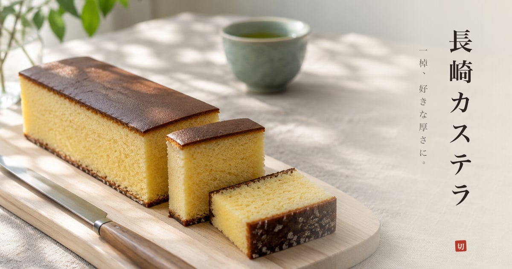

<p align="center"></p>

# 長崎カステラ

**A loaf of Nagasaki castella you slice with your finger.** Fullscreen, real-time 3D, for phones and desktops.

- **Swipe** across the cake: a sujihiki comes over, presses the crust in, breaks through, saws down to the board,
  and tips a thin slice over onto its side.
- **Press and hold** a piece: the sponge gives under your fingertip. **Move** while holding: you lift it and carry it.
- **Two fingers** (or right-drag, or shift-drag) turn the view; **pinch** (or the wheel) comes closer; a **double tap**
  puts the view back. **もう一棹** brings a new loaf.

## The castella

Built from references found online: Fukusaya's own pages (a 1号 loaf is 580 g in ten slices; batter poured into a
paper-lined wooden frame; zarame sugar left to settle at the base), a Shooken 1号 box of 28.5 × 10 × 6.5 cm, and many
photographs of cut castella, from dancyu, Tennen Seikatsu and the makers (the caramel band under the top, the yellow
fine crumb, the dark sugary base). Colours were sampled from those photographs.

- The loaf is **27 × 9 × 6 cm** and **398 kg/m³** (so 580 g). It is cut from a baked slab, so its four sides are cut
  crumb, and only the top (a satin caramel skin) and the bottom (dark, with zarame) are crust.
- **The cut is exact** (`src/slice.js`): the mesh is clipped by the knife's plane, both halves stay watertight, and
  the hole is closed with a new face of crumb, triangulated with a constrained Delaunay grid. Pieces keep the loaf's
  own coordinates, and the shader draws the sponge from where each point was inside the loaf, so neighbouring slices
  line up exactly: the crust band, the golden crumb under it, the base and its sugar crystals.
- **The physics** (`src/physics.js`, Rapier): every piece is a rigid body with its true mass, the convex polytope
  of the loaf's box cut by every plane it has received, friction 0.78, no bounce. The blade is a kinematic body: it
  wedges the halves apart and, by tilting, tips a slice thinner than 3.1 cm over; a thicker piece only parts.
- **The sponge gives** (`src/castella.js`): the knife's edge is a line load that pushes a V-shaped crease into the crust
  before it breaks through; a fingertip is a round dimple. Both fade over a few millimetres and toward the supported
  base, and the normals are bent analytically so the light reads them. A piece that lands hard squashes and springs back
  (a damped spring at 14 Hz driven by the contact force).
- **Crumbs** (`src/crumbs.js`): flakes of crust settle along the cut on the cake; bits of crumb, crust and sugar fall
  from where the blade comes out and come to rest on the washi.

## The pictures

- `blender/scene.py` (Blender, headless) builds the loaf mesh, the hinoki board, the washi sheet, the knife and the
  yunomi, exports `public/scene.glb`, and renders the morning room in Cycles as a 360° HDR panorama that lights the
  scene and is what the knife reflects.
- `scripts/imagegen.mjs` paints every photograph with Codex CLI's built-in image_gen: the crumb, the top crust, the
  sugared base, the hinoki, the linen, the washi, the maple-leaf shadows that the window light carries as a gobo, the
  wall behind, and the photographs for the icon and the link preview.
- `scripts/textures.py` makes them tile and grades the cake's colours to the photographs of real castella;
  `scripts/art.mjs` makes the icons, the link preview and the manifest.

## Run it

```sh
npm install
npm run dev                    # http://localhost:5190  (?qa: fixed time steps, for tests)
npm run build && vercel deploy --prod

/Applications/Blender.app/Contents/MacOS/Blender -b -P blender/scene.py
node scripts/imagegen.mjs      # needs a logged-in Codex CLI
python3 scripts/textures.py && node scripts/art.mjs
node scripts/test/slice.test.mjs && node scripts/test/stress.test.mjs   # the cutting geometry
node scripts/qa.mjs http://localhost:5191/ local            # every state, 9 screens, Chrome + WebKit, with checks
node scripts/qa.mjs https://nagasaki-castella.vercel.app/ prod
node scripts/compare.mjs qa/local qa/prod                    # pixel parity between the two runs
```

With `?qa` the page's clock stops and only moves when a test steps it, transitions are off and the crumbs are seeded,
so a build renders the same pixels every time; the QA run checks layout, fonts, canvas size, console, and the physics
(the cake's volume is conserved through every cut, every piece comes to rest, nothing sinks into the board).
