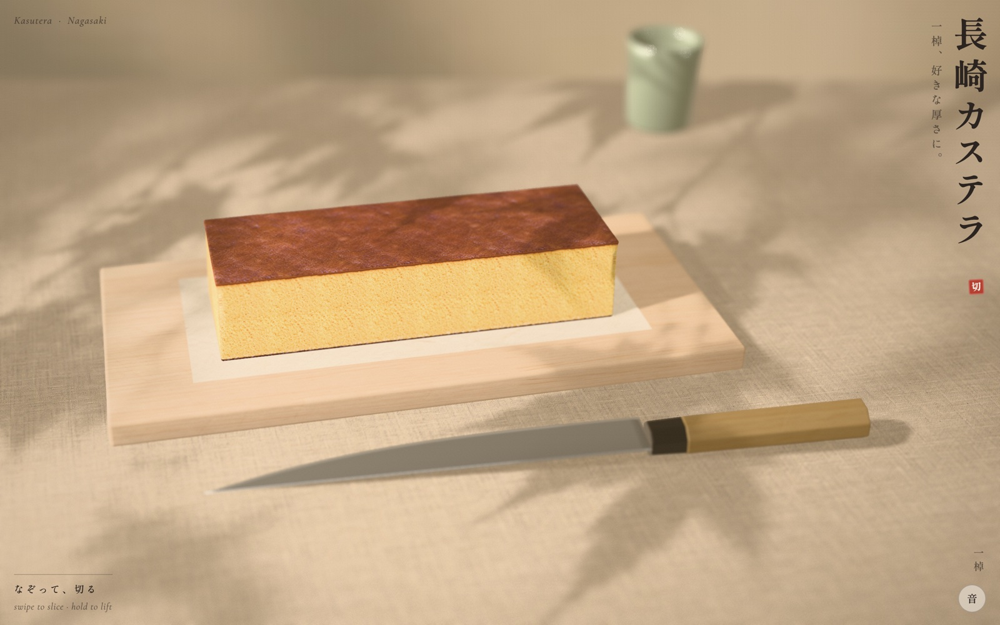

<p align="center">
  <a href="https://nagasaki-castella.vercel.app/"></a>
</p>

<h1 align="center">長崎カステラ</h1>

<p align="center">
  <b>A loaf of Nagasaki castella you slice with your finger.</b><br />
  Zero calories. Infinite slices. A rigid-body physics engine, for cake.
</p>

<p align="center">
  <a href="https://nagasaki-castella.vercel.app/"><b>🔪 Cut it yourself → nagasaki-castella.vercel.app</b></a>
</p>

---

Somebody looked at a box of Fukusaya castella, a cake that has been perfectly fine since the 1600s, and thought:
*what if this needed Rapier, a constrained Delaunay triangulator, and a 360° HDR panorama rendered in Blender?*

This is that. A fullscreen, real-time 3D Nagasaki castella for phones and desktops. You swipe, a sujihiki comes over,
presses into the crust, breaks through, saws down to the board, and tips a thin slice onto its side. Then crumbs fall
on the washi, and you feel a calm that no actual cake has ever given you, because nobody has to wash the knife.

<p align="center">
  
  <br /><sub>六切れ. Five cuts, six pieces, zero dishes.</sub>
</p>

## How to eat it (you can't)

| Do this | And this happens |
| --- | --- |
| **Swipe** across the cake | The knife comes over and cuts exactly where you swiped. Thin slices tip over. Thick ones just part, with dignity. |
| **Press and hold** a piece | The sponge gives under your fingertip. Yes, it's squishy. Yes, you'll do it more than once. |
| **Hold and move** | You pick the piece up and carry it around. Please don't drop it. (You will drop it. It squashes and springs back at 14 Hz.) |
| **Two fingers**, right-drag or shift-drag | Turn the view, like a food critic circling the plate. |
| **Pinch** or scroll | Get closer. Closer. Look at that crumb. |
| **Double tap** | Puts the view back where it started. |
| **もう一棹** | A whole new loaf. The castella economy is post-scarcity. |
| **音** | Sound on or off, for cutting cake in meetings. |

The counter in the corner keeps score in kanji: 一棹 for the whole loaf, then 二切れ, 三切れ, and so on up to
九十九切れ. Past that it gives up and switches to Arabic numerals, like a tourist who ran out of phrasebook.

## FAQ

**Can I eat it?**
No. We tried. The screen tastes like glass and regret.

**Why won't my slice fall over?**
Because it's thicker than 3.1 cm, which makes it a *piece*, not a *slice*, and pieces stand their ground. Cut thinner.

**Is the cake's volume really conserved through every cut?**
Yes. The QA run checks. This cake does better bookkeeping than most startups.

**Why is the loaf exactly 580 g?**
A Fukusaya 1号 loaf is 580 g. The loaf here is 27 × 9 × 6 cm at 398 kg/m³, which comes out to… 580 g. We did the math so
the knife could feel the weight of its choices.

**Is this a cake or a physics thesis?**
Yes.

## The serious part

Built from references found online: Fukusaya's own pages (a 1号 loaf is 580 g in ten slices; batter poured into a
paper-lined wooden frame; zarame sugar left to settle at the base), a Shooken 1号 box of 28.5 × 10 × 6.5 cm, and many
photographs of cut castella, from dancyu, Tennen Seikatsu and the makers (the caramel band under the top, the yellow
fine crumb, the dark sugary base). Colours were sampled from those photographs.

- **The loaf** is cut from a baked slab, so its four sides are cut crumb, and only the top (a satin caramel skin) and
  the bottom (dark, with zarame) are crust.
- **The cut is exact** (`src/slice.js`): the mesh is clipped by the knife's plane, both halves stay watertight, and the
  hole is closed with a new face of crumb, triangulated with a constrained Delaunay grid. Pieces keep the loaf's own
  coordinates, and the shader draws the sponge from where each point was inside the loaf, so neighbouring slices line
  up exactly: the crust band, the golden crumb under it, the base and its sugar crystals.
- **The physics** (`src/physics.js`, Rapier): every piece is a rigid body with its true mass, the convex polytope of the
  loaf's box cut by every plane it has received, friction 0.78, no bounce. The blade is a kinematic body: it wedges the
  halves apart and, by tilting, tips a slice thinner than 3.1 cm over; a thicker piece only parts.
- **The sponge gives** (`src/castella.js`): the knife's edge is a line load that pushes a V-shaped crease into the crust
  before it breaks through; a fingertip is a round dimple. Both fade over a few millimetres and toward the supported
  base, and the normals are bent analytically so the light reads them. A piece that lands hard squashes and springs
  back (a damped spring at 14 Hz driven by the contact force).
- **Crumbs** (`src/crumbs.js`): flakes of crust settle along the cut on the cake; bits of crumb, crust and sugar fall
  from where the blade comes out and come to rest on the washi.

### The pictures

- `blender/scene.py` (Blender, headless) builds the loaf mesh, the hinoki board, the washi sheet, the knife and the
  yunomi, exports `public/scene.glb`, and renders the morning room in Cycles as a 360° HDR panorama that lights the
  scene and is what the knife reflects.
- `scripts/imagegen.mjs` paints every photograph with Codex CLI's built-in image_gen: the crumb, the top crust, the
  sugared base, the hinoki, the linen, the washi, the maple-leaf shadows that the window light carries as a gobo, the
  wall behind, and the photographs for the icon and the link preview.
- `scripts/textures.py` makes them tile and grades the cake's colours to the photographs of real castella;
  `scripts/art.mjs` makes the icons, the link preview and the manifest.

## Run it

```sh
npm install
npm run dev                    # http://localhost:5190  (?qa: fixed time steps, for tests)
npm run build && vercel deploy --prod

/Applications/Blender.app/Contents/MacOS/Blender -b -P blender/scene.py
node scripts/imagegen.mjs      # needs a logged-in Codex CLI
python3 scripts/textures.py && node scripts/art.mjs
node scripts/test/slice.test.mjs && node scripts/test/stress.test.mjs   # the cutting geometry
node scripts/qa.mjs http://localhost:5191/ local            # every state, 9 screens, Chrome + WebKit, with checks
node scripts/qa.mjs https://nagasaki-castella.vercel.app/ prod
node scripts/compare.mjs qa/local qa/prod                    # pixel parity between the two runs
```

With `?qa` the page's clock stops and only moves when a test steps it, transitions are off and the crumbs are seeded,
so a build renders the same pixels every time; the QA run checks layout, fonts, canvas size, console, and the physics
(the cake's volume is conserved through every cut, every piece comes to rest, nothing sinks into the board).

---

<p align="center"><sub>No castella was harmed in the making of this repository. Several were eaten for research.</sub></p>
