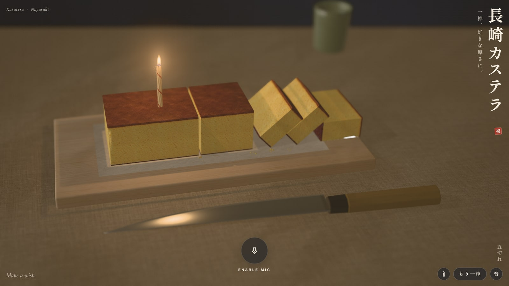
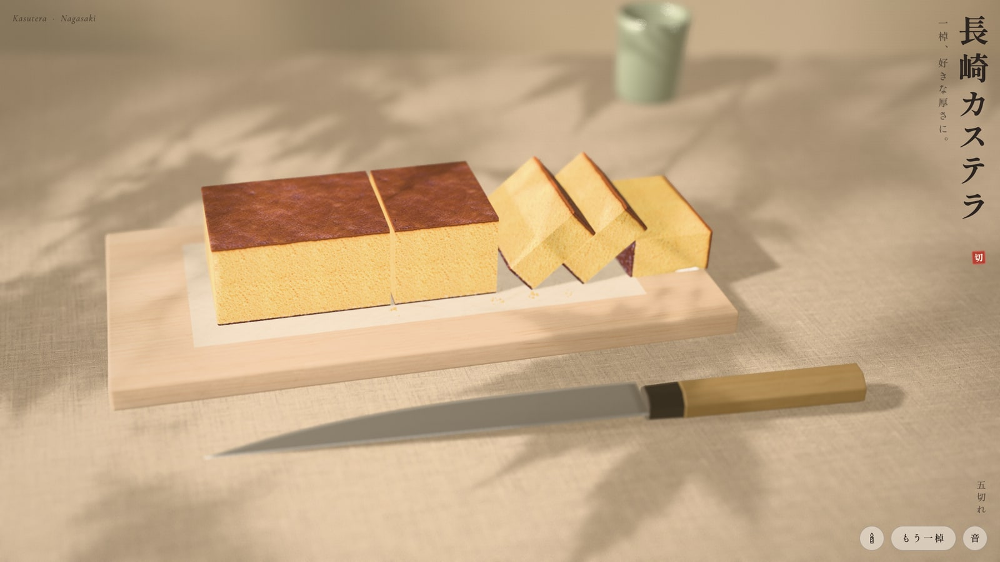
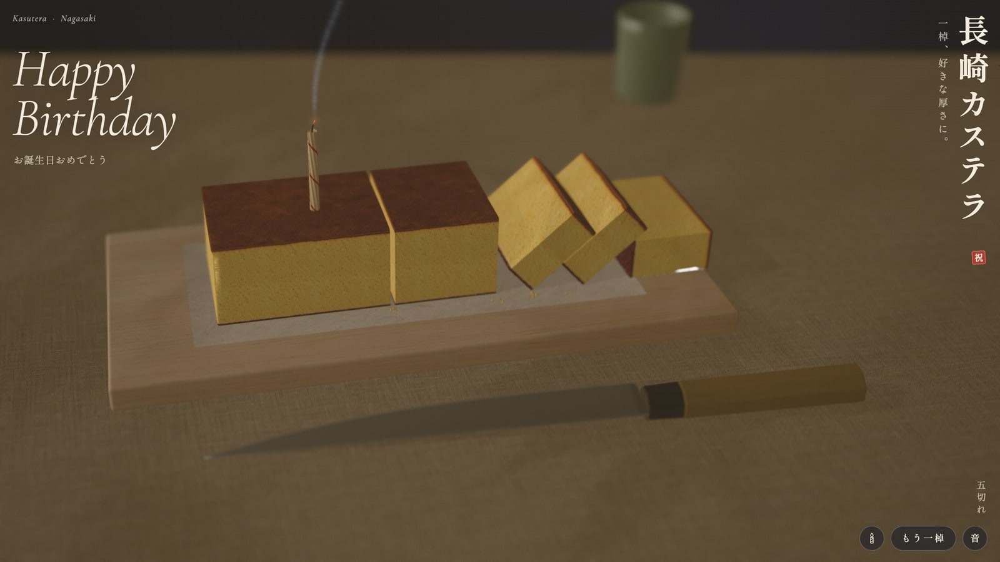

<p align="center">
  <a href="https://davidyen1124.github.io/slice-of-life-crisis/"></a>
</p>

<h1 align="center">Slice of Life Crisis</h1>

<p align="center">
  <b>You're another year older. Here is a cake you can't eat, a knife you can't hold, and a candle that listens to you breathe.</b><br />
  Zero calories. Infinite slices. One candle, simulated harder than your career.
</p>

<p align="center">
  <a href="https://davidyen1124.github.io/slice-of-life-crisis/"><b>🔪 Cut it yourself → davidyen1124.github.io/slice-of-life-crisis</b></a>
  &nbsp;·&nbsp;
  <a href="https://davidyen1124.github.io/slice-of-life-crisis/?name=Mika"><b>🕯️ It's Mika's birthday</b></a>
</p>

---

Somebody looked at a box of Fukusaya castella, a cake that has been perfectly fine since the 1600s, and thought:
*what if this needed Rapier, a constrained Delaunay triangulator, and a 360° HDR panorama rendered in Blender?*
Then a birthday happened, and the question got worse: *what if it also needed a microphone, a flame simulation, and the
lights going down like a restaurant that's about to sing at you?*

This is that. A fullscreen, real-time 3D Nagasaki castella for phones and desktops. You swipe, and a sujihiki comes over
with the calm of a chef who has been doing this for forty years and has opinions about your knife skills. It presses into
the crust, breaks through, saws down to the board, and tips a thin slice onto its side. Then you press 🕯, poke the
slice you love most, and a spiral birthday candle is pushed 16 mm into the sponge. It lights itself. The morning drains
out of the room like your twenties. You hold the button and blow at your laptop, and a coworker you didn't know was
there asks if you're okay. You are not. You are 34.

<p align="center">
  
  <br /><sub>五切れ. Four cuts, five pieces, zero dishes, one mild sense of accomplishment.</sub>
</p>

## How to eat it (you can't)

| Do this | And this happens |
| --- | --- |
| **Swipe** across the cake | The knife comes over and cuts exactly where you swiped. Thin slices tip over. Thick ones just part, with dignity. |
| **Press and hold** a piece | The sponge gives under your fingertip. Yes, it's squishy. Yes, you'll do it more than once. We all do. |
| **Hold and move** | You pick the piece up and carry it around. Please don't drop it. (You will drop it. It squashes and springs back at 14 Hz.) |
| **Two fingers**, right-drag or shift-drag | Turn the view, like a food critic circling the plate before saying something cruel. |
| **Pinch** or scroll | Get closer. Closer. Look at that crumb. That crumb has a better skincare routine than you. |
| **Double tap** | Puts the view back where it started. If only. |
| **🕯** (after the first cut) | Pick up a candle. Tap any piece and it goes in right there. It lights, and the lights go down. Tap 🕯 again to move it, because you changed your mind, because of course you did. |
| **Hold the button and blow** | The flame bends, strains, goes blue at the root and goes out. Smoke. *Happy Birthday.* The lights come back up. Nobody claps. It's a website. |
| **Relight** | Do it again. Nobody's counting. (Your age is. Your age is always counting.) |
| **もう一棹** | A whole new loaf. The castella economy is post-scarcity. Your metabolism is not. |
| **音** | Sound on or off, for blowing out candles in meetings. |

The candle is part of the cake's physics, not a sticker on it, because we have no chill:

- **Carry the slice it's in** and the flame trails behind you. Carry it fast enough and you've blown it out yourself,
  which does not count as a wish. You ran with a lit candle. Your mother warned you about this.
- **Cut off the slice it's in** and the slice tips over with the candle still in it. The candle now sticks out sideways
  and the flame keeps burning straight up, because that's what flames do. Physics doesn't care about your aesthetic.
- **Bring the knife down on the candle** and it's knocked out of the cake and rolls away, smoking, like it's leaving a
  party early. The seal by the title goes back from 祝 (celebrate) to 切 (cut). The vibes have shifted.
- **Turn a lit candle upside down** and it's smothered. We tried to make it keep burning upside down. Newton said no.

<p align="center">
  
  <br /><sub>One second after. Your wish has been received and placed in a queue. Estimated processing time: 3–5 business decades.</sub>
</p>

**Personalise it:** add `?name=` to the link, e.g. [`?name=Mika`](https://davidyen1124.github.io/slice-of-life-crisis/?name=Mika).
The candle goes in by itself, the lights go down, and the headline sings their name. Send it to someone you love, or to
someone whose birthday you remembered at 11:52 pm. It's basically a gift. It's free. It's the thought that counts, and
the thought here was 2,000 lines of JavaScript.

The counter in the corner keeps score in kanji: 一棹 for the whole loaf, then 二切れ, 三切れ, and so on up to 九十九切れ.
Past that it gives up and switches to Arabic numerals, like a tourist who ran out of phrasebook.

## FAQ

**Can I eat it?**
No. We tried. The screen tastes like glass and regret, which is also how 34 tastes.

**Why is it called Slice of Life Crisis?**
Because every birthday you cut a little more off the loaf, and the loaf does not grow back. (Here it does. Press
もう一棹. Must be nice.)

**Can I put my actual age in candles?**
No. One candle. The flame is a streakline simulation of every bit of gas that left the wick in the last 60 ms, and at your
age we'd need a render farm and a fire extinguisher. Also: castella is not a fire hazard and we'd like to keep it that way.

**Will singing "Happy Birthday" louder put it out?**
No. A voice is loud but moves almost no air, and the page can tell. It measures spectral flatness: breath is noise,
singing is harmonic, and singing only counts for part of its level. You have to actually blow. Like an adult. At a laptop.

**Is it recording me?**
No. Your breath only counts while you hold the button, and nothing is recorded or uploaded: the audio becomes a wind speed
inside your browser and that's the end of it. The candle is a very small, very judgmental weather station.

**I'm in a library / my mic is blocked / I have no mic.**
Then holding the button is the breath. The page says "Hold to blow instead" and you can turn another year older in total
silence, which is honestly how most of us do it.

**Why won't my slice fall over?**
Because it's thicker than 3.1 cm, which makes it a *piece*, not a *slice*, and pieces stand their ground. Cut thinner.
Also check there isn't another piece leaning on it. Physics is a team sport, and your slice has no friends.

**Is the cake's volume really conserved through every cut?**
Yes. The QA run checks, candle or no candle. This cake does better bookkeeping than most startups.

**Why is the loaf exactly 580 g?**
A Fukusaya 1号 loaf is 580 g. The loaf here is 27 × 9 × 6 cm at 398 kg/m³, which comes out to… 580 g. The candle is 2 g of
paraffin. We did the math so the knife could feel the weight of its choices. You should try it sometime.

**Is this a cake or a physics thesis?**
Yes. And now it's also a birthday card. Scope creep is a lifestyle.

## The serious part (we're so sorry)

Built from references found online: Fukusaya's own pages (a 1号 loaf is 580 g in ten slices; batter poured into a
paper-lined wooden frame; zarame sugar left to settle at the base), a Shooken 1号 box of 28.5 × 10 × 6.5 cm, many
photographs of cut castella, from dancyu, Tennen Seikatsu and the makers (the caramel band under the top, the yellow fine
crumb, the dark sugary base), and an unreasonable amount of candle macro and blow-out photography. Colours were sampled
from those photographs, not vibes.

### The cake

- **The loaf** is cut from a baked slab, so its four sides are cut crumb, and only the top (a satin caramel skin) and the
  bottom (dark, with zarame) are crust. Yes, we thought about this. No, nobody asked.
- **The cut is exact** (`src/slice.js`): the mesh is clipped by the knife's plane, both halves stay watertight, and the
  hole is closed with a new face of crumb, triangulated with a constrained Delaunay grid. Pieces keep the loaf's own
  coordinates, and the shader draws the sponge from where each point was inside the loaf, so neighbouring slices line up
  exactly: the crust band, the golden crumb under it, the base and its sugar crystals.
- **The physics** (`src/physics.js`, Rapier): every piece is a rigid body with its true mass, the convex polytope of the
  loaf's box cut by every plane it has received, friction 0.78, no bounce. The blade is a kinematic body: it wedges the
  halves apart and, by tilting, tips a slice thinner than 3.1 cm over; a thicker piece only parts.
- **The sponge gives** (`src/castella.js`): the knife's edge is a line load that pushes a V-shaped crease into the crust
  before it breaks through; a fingertip is a round dimple. Both fade over a few millimetres and toward the supported base,
  and the normals are bent analytically so the light reads them. A piece that lands hard squashes and springs back (a
  damped spring at 14 Hz driven by the contact force). It's more emotionally resilient than most of us.
- **Crumbs** (`src/crumbs.js`): flakes of crust settle along the cut on the cake; bits of crumb, crust and sugar fall from
  where the blade comes out and come to rest on the washi. Nobody sweeps them up. That's the dream.

### The candle (and the crisis)

- **The candle** (`src/candle.js`): a slim spiral birthday candle, 6.2 mm across and 74 mm long, with eight twisted flutes,
  a melted cup at the top, a braided cotton wick that curls over at the tip, and one vermilion stripe that follows the
  spiral. Ivory wax whose light wraps a little way round it and glows near the flame. It has better lighting than your
  passport photo.
- **Where it goes** (`src/birthday.js`): pieces are convex, so finding the spot is a matter of planes: straight down into
  the top of the piece under your finger, at least 4.6 mm from its sides, up to 16 mm deep (less in a thin piece; not at
  all in a shaving, which gets a polite "too thin for a candle"). It comes down, the sponge dimples around it, and it goes in.
- **It's part of the cake**: the wax standing out of the sponge becomes a cylinder collider on the piece's own rigid body,
  so it's carried, tipped and propped up with it. After a cut, the half that holds its place keeps it. A blade that comes
  down within a few millimetres of it knocks it out of the cake: it becomes a 2 g body of its own, finally independent,
  briefly on fire.
- **Breath → air** (`src/breath.js`): the microphone runs without voice processing, band-limited to < 1.6 kHz. Blowing on a
  capsule is wind noise, p′ ∝ ½ρU², so air speed is U ∝ √(level above the room's noise floor). A voice is loud but moves
  little air: spectral flatness tells harmonic sound from noise, and a voice counts for only part of its level. The puff
  reaches the flame with a short lag, carries on briefly after you stop, and is turbulent, like your thirties.
- **Flame** (`src/flame.js`): a streakline. The flame is the gas that left the wick in the last ~60 ms. A parcel of age τ
  has risen ½aτ² and been carried sideways by the air it met on the way up, so gusts travel from root to tip. That air is
  your breath plus the candle's own movement, which is why a carried candle trails its flame. Under strain it shortens,
  thins and turns blue. It lights the room as a ~1850 K point light at the middle of its luminous zone, with shadows,
  and it puts a little reflection of itself in the knife blade, because it's that kind of flame.
- **Blow-out**: a blow-off. Past ~1.9 m/s at the base, the flame loses heat at a rate that grows with (U/U꜀ − 1)^1.5;
  below it, it recovers. Gentle breath bends it; a firm breath puts it out in about a second; a hard one in under half a
  second, and also your laptop now has a story to tell.
- **Smoke** (`src/smoke.js`): parcels of warm air with buoyancy that fades as they mix, drag toward the local air (a
  divergence-free curl field that grows with height, plus the leftover breath). The thread is drawn as a streakline
  ribbon, laminar near the wick and curling higher up; each parcel leaves from where the wick was when it left, so a
  candle knocked over still trails one continuous thread, dramatically, as it should.
- **The picture**: the flame, its glow and the smoke are drawn after the lens blur, in focus (the camera focuses on the
  candle while it burns, like a good friend at a party), and each looks up the scene's depth so a piece in front still
  hides them. "The lights go down" is the room itself dimming: the sun, the bounce, the window light and the wall, with the
  page's ink turning to paper in step. Then it all comes back up, and it's just Tuesday again.

### The pictures

- `assets-src/blender/scene.py` (Blender, headless) builds the loaf mesh, the hinoki board, the washi sheet, the knife and
  the yunomi, exports `public/scene.glb`, and renders the morning room in Cycles as a 360° HDR panorama that lights the
  scene and is what the knife reflects.
- `scripts/imagegen.mjs` paints every photograph with Codex CLI's built-in image_gen: the crumb, the top crust, the sugared
  base, the hinoki, the linen, the washi, the maple-leaf shadows the window light carries as a gobo, the wall behind, the
  candle's wax, the 祝 seal, and the photographs for the icon and the link preview. No real castella was photographed. Some
  were eaten.
- `scripts/textures.py` makes them tile and grades the cake's colours to the photographs of real castella;
  `scripts/art.mjs` makes the icons, the link preview, the seal and the manifest.

## Run it

```sh
npm install
npm run dev                    # http://localhost:5190  (?qa: fixed time steps, for tests · ?name=Mika: a birthday link)
npm run build                  # static site in dist/; pushing to main deploys it to GitHub Pages

/Applications/Blender.app/Contents/MacOS/Blender -b -P assets-src/blender/scene.py
node scripts/imagegen.mjs      # needs a logged-in Codex CLI
python3 scripts/textures.py && node scripts/art.mjs
npm test                                                    # the cutting geometry
node scripts/qa.mjs http://localhost:5191/ local            # every state, 40 screens a device, 9 devices, Chrome + WebKit
node scripts/qa.mjs https://davidyen1124.github.io/slice-of-life-crisis/ live
node scripts/compare.mjs qa/local qa/live                   # pixel parity between two runs (--mask: leave out the candle button)
node scripts/physics-qa.mjs http://localhost:5191/          # the microphone path, with recorded breath, speech and silence
node scripts/motion.mjs http://localhost:5191/              # films it in real time: frame strips and GIFs of the movement
node scripts/docs.mjs http://localhost:5191/                # the pictures in this README
```

With `?qa` the page's clock stops and only moves when a test steps it, transitions are off, and the crumbs and the smoke
are seeded, so a build renders the same pixels every time. The QA run checks layout, fonts, canvas size, the console, the
physics (the cake's volume is conserved through every cut, every piece comes to rest, nothing sinks into the board), and
the birthday (the candle goes in where it's tapped, lights, survives a gentle breath, goes out in a hard one, says Happy
Birthday, relights, and gets knocked over by the knife; a birthday link with the microphone refused blows out by holding
the button). It is, by a wide margin, the most thoroughly tested birthday card in the world.

---

<p align="center"><sub>No castella was harmed in the making of this repository. Several were eaten for research. Please don't blow on the actual screen: it doesn't help, and your coworkers can see you.</sub></p>
